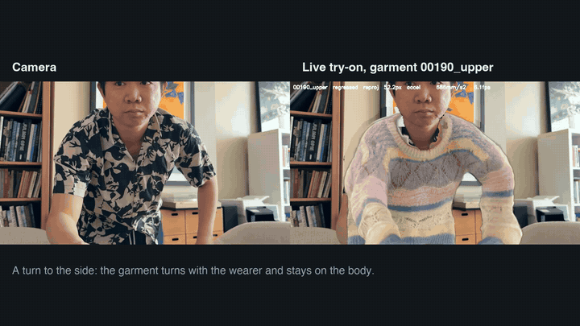

# Live 3D virtual try-on

Put a captured 3D garment on a person in a webcam: it follows their motion,
turns with them, and replaces what they are wearing. The garments are
[Gaussian Garments](https://github.com/eth-ait/Gaussian-Garments) (captured
3D Gaussian-splat clothing), worn on an SMPL-X body regressed from the
camera. Runs on an Apple M1 (no CUDA). Every stage names its method and its
measured number; what is planned and what was tried and dropped is in
[`docs/ROADMAP.md`](docs/ROADMAP.md).

## Start here

```bash
./live-tryon                # pick a garment, then the live webcam try-on
./live-tryon help           # every command: menu, run, garments, bench, record, pipeline, doctor, test, compare
./live-tryon doctor         # what this machine has, and which GPU each stage uses
```

## Demo



[docs/demo/live-run-20261017.mp4](docs/demo/live-run-20261017.mp4) is a live run on the laptop camera (17 Oct 2026).

[docs/demo/demo.mp4](docs/demo/demo.mp4) (59 s): the laptop camera on the left, the live try-on on the right
(garment 00190_upper, Apple M1, no CUDA GPU; wearer not recorded), then the measured results. The
garment belongs to the Gaussian Garments authors and is shown for research and evaluation (third-party
terms in `LICENSE`). Record your own:

```bash
./live-tryon bench 00190_upper 200       # stand 2-3 m from the camera; saves the camera frames and the output
python -m tools.data.make_demo_video --camera ~/tryon-data/captures/bench-<time>-input.mp4 \
    --tryon ~/tryon-data/captures/bench-<time>.mp4
```

## Documentation

| read | for |
|---|---|
| [docs/USAGE.md](docs/USAGE.md) | running it: every option, the display modes, speed and accuracy, GPU setup, limitations, troubleshooting |
| [docs/ARCHITECTURE.md](docs/ARCHITECTURE.md) | the code: one frame through the modules, what each folder holds, a reading order |
| [docs/DATASETS.md](docs/DATASETS.md) | every dataset and model file: where it lives, where it was downloaded from, what was dropped |
| [docs/ROADMAP.md](docs/ROADMAP.md) | where the project stands, the targets, what is next, what was tried and dropped |
| [docs/REFERENCE_RUNS.md](docs/REFERENCE_RUNS.md) | other try-on systems run on this machine for comparison |

## Project layout

    live-tryon          the launcher: menu, run, garments, bench, record, pipeline, doctor, test, compare
    setup.sh, doctor.py first-time setup; a check of this machine
    tryon/              the system, one package by responsibility
      app/              the live loop (pipeline.py), display modes, command line (cli.py)
      body/             the person's 3D body: NLF regressor, SMPL-X fitter, smoothing, orientation
      garment/          the garment on that body: skinning, cloth, collision, renderer, shading
      rendering/        Gaussian-splat rasterisers (CPU reference, OpenGL)
      removal/          erasing the person's own clothing: parsers, fill, background plate
      paths.py          where every file lives (one place; TRYON_DATA moves the data root)
    tools/
      evaluate/         one tool per measurement; results go to docs/baseline/
      train/            training the project's own networks (shading students, orientation)
      data/             downloads, pose fits, the demo video (make_demo_video.py)
      record_session.py the guided camera recording behind ./live-tryon record
    tests/              test_<folder>_<module>.py for each module
    docs/               the documents above; baseline/ (results), figures/
    models/, data/      weights and test data (git-ignored; ./setup.sh fills models/)

    ~/tryon-data/       outside the repository (TRYON_DATA moves it; docs/DATASETS.md):
      garments/ trajectories/ release_videos/ body_models/smplx/ references/ captures/ training_logs/

Run everything from the repository root: `python -m tryon.app` for the live
system, `python -m tools.evaluate.<tool>` for a measurement.

## The pipeline (one live frame)

    webcam frame (at most 960 px wide)
      -> 2D keypoints        MediaPipe Pose (BlazePose)                  tryon/app/person.py
      -> SMPL-X body         NLF-S image regressor                       tryon/body/regressor.py, nlf_worker.py
                             (fallbacks: Multi-HMR, then the keypoint fit tryon/body/fitter.py)
      -> garment on body     linear blend skinning from the scan pose    tryon/garment/skinning.py
      -> cloth               springs toward the skinned pose + collision tryon/garment/cloth.py, collision.py
      -> appearance          distilled shading network (worker thread)   tryon/garment/shading_student.py
      -> render              Gaussian splats on the GPU (OpenGL)         tryon/rendering/splat_gl.py
                             (splat_cpu.py: the numba reference)
      -> clothing removal    SCHP parser near the body; fill             tryon/removal/remover.py
      -> composite           face, hair and hands stay in front          tryon/app/compositing.py

The loop that runs it is `tryon/app/pipeline.py::run`. **[docs/ARCHITECTURE.md](docs/ARCHITECTURE.md)**
walks through one frame in the code and suggests a reading order.

In the default display every shown frame carries the garment drawn for it, at the
pipeline's rate (7.3-7.5 fps on the M1 on a video file, 4.4-4.8 before the 8 Oct speed work; the body regressor works on the
next frame while this one is drawn). Smooth mode (`--smooth`) shows
every camera frame and carries the newest garment with the torso; it shows the clip's rate
(25 fps on the release clips), and its rate on the webcam was never logged.
`--delayed` shows smooth mode about a second late, with the garment from the
nearest pipeline frame.

## Where it stands (measured)

| | number | source |
|---|---|---|
| garment IoU vs the real garment, 5 release videos | **0.730** (the authors' fit, four cameras: 0.827) | `tools/evaluate/vs_registration.py` |
| body accuracy (PA-MPJPE) | **24.6 mm** on 16 development views (keypoint fit 87-94 mm); 42.5 mm on 4,208 unselected views | `docs/baseline/body-regressors.json`, `docs/baseline/body-accuracy-4ddress.json` |
| garment present, 6 recorded webcam sessions | **98.6 %** of 13,178 frames (100 % on 15 release videos; 90.1 % on session 1 and 89.5 % on the 17 Oct recording) | `tools/evaluate/session_benchmark.py` |
| tests | **512** on 17 Oct (503 passed, 9 skipped); 513 after the intrinsics fix of the classical tool | `./live-tryon test` |
| work a frame, M1 (median per run) | 125-411 ms in 14 of 17 timed runs; three above 0.5 s, all on a loaded machine: 670 and 602 ms (two 10 Oct replays before that day's fixes) and 1,034 ms (the turn replay); default display 7.3-7.5 fps on a video file (smooth mode's rate on the webcam was never logged) | `python -m tryon.app --profile`, `tools/evaluate/session_benchmark.py` |

## Setup, step by step

Tested on macOS with Apple Silicon (M1, 16 GB). Tick each box in order;
`./live-tryon doctor` checks most of them for you.

- [ ] **1. Tools**: Python 3.10, git, and [uv](https://docs.astral.sh/uv/)
      (`brew install python@3.10 uv`).
- [ ] **2. SMPL-X body models** (licence, manual): register at
      https://smpl-x.is.tue.mpg.de, download SMPL-X v1.1, put the `.npz`
      files in `~/tryon-data/body_models/smplx/`.
- [ ] **3. Garment checkpoints** (manual): Gaussian Garments models of
      4D-DRESS subjects in `~/tryon-data/garments/<name>/` (each with
      `stage1/`), and the authors' trajectory files in
      `~/tryon-data/trajectories/` (`docs/DATASETS.md`).
- [ ] **4. Everything else**: `./setup.sh` - the Python environment, the
      SCHP parsers, the NLF-S body regressor and its environment, and each
      garment's scan pose. The 15 scan poses ship in `assets/scan_poses/`
      (four of them hand-refined, `refined=1`, because the authors'
      trajectory does not hold their template's body); setup copies them
      into the checkpoints that lack one, never over an existing file, and
      fits (and, when the trajectory frame is not the template, refines) a
      pose only for a garment with no asset. `./live-tryon doctor` lists
      where each pose comes from. Re-running it only does what is missing.
- [ ] **5. Check**: `./live-tryon doctor` ends with `Ready.` and lists MPS,
      SCHP on CoreML, OpenGL on Metal and NLF-S as available.
- [ ] **6. Tests**: `./live-tryon test` passes.
- [ ] **7. Try it**: `./live-tryon`, pick a garment, stand 2-3 m from
      the camera. macOS asks once for camera access for the terminal.

Optional: Multi-HMR as a second body regressor (clone
https://github.com/naver/multi-hmr into `models/pretrained/multi-hmr`, put
`multiHMR_672_S.pt` in its `models/multiHMR/`, symlink its `models/smplx`
to the SMPL-X models, `pip install --no-deps roma`); Big-LaMa for the
offline quality fill (`tools/data/download_pretrained.py lama`). GPU notes,
including NVIDIA, are in docs/USAGE.md, "GPU setup".

## Methods and references

| stage | method | reference |
|---|---|---|
| 2D keypoints | BlazePose via MediaPipe Pose | Bazarevsky et al., *BlazePose: On-device Real-time Body Pose Tracking*, CVPR-W 2020 |
| body model | SMPL-X | Pavlakos et al., *Expressive Body Capture: 3D Hands, Face, and Body from a Single Image*, CVPR 2019 |
| 3D body from the image | NLF-S (default) | Sárándi & Pons-Moll, *Neural Localizer Fields for Continuous 3D Human Pose and Shape Estimation*, NeurIPS 2024 - [github.com/isarandi/nlf](https://github.com/isarandi/nlf) |
| | Multi-HMR (fallback) | Baradel et al., *Multi-HMR: Multi-Person Whole-Body Human Mesh Recovery in a Single Shot*, ECCV 2024 |
| | keypoint fit (fallback) | SMPLify-style optimisation: Bogo et al., *Keep it SMPL*, ECCV 2016 |
| keypoint smoothing | One Euro filter | Casiez et al., CHI 2012 |
| garment representation | Gaussian Garments (mesh-bound 3D Gaussians + appearance network) | Rong et al., *Gaussian Garments: Reconstructing Simulation-Ready Clothing with Photorealistic Appearance from Multi-View Video*, 3DV 2025 - [github.com/eth-ait/Gaussian-Garments](https://github.com/eth-ait/Gaussian-Garments) |
| capture data | 4D-DRESS | Wang et al., *4D-DRESS: A 4D Dataset of Real-World Human Clothing with Semantic Annotations*, CVPR 2024 |
| garment follows body | linear blend skinning, inverse-skinned from the scan pose | Loper et al., *SMPL*, SIGGRAPH Asia 2015 |
| cloth | damped springs toward the skinned pose (`LightCloth`), body collision, strain limiting | Müller et al., *Position Based Dynamics*, 2007 (collision projection); Provot, *Deformation Constraints in a Mass-Spring Model*, 1995 |
| rendering | 3D Gaussian splatting (EWA splats), CPU (numba) and OpenGL | Kerbl et al., *3D Gaussian Splatting for Real-Time Radiance Field Rendering*, SIGGRAPH 2023; Zwicker et al., *EWA Splatting*, 2002 |
| clothing parser | SCHP (ATR and LIP label sets) | Li et al., *Self-Correction for Human Parsing*, TPAMI 2020 |
| fill | learned background plate, Telea inpainting; Big-LaMa (offline) | Telea, 2004; Suvorov et al., *LaMa*, WACV 2022 |
| evaluation reference | the real garment (SCHP mask of the real frame); the authors' fit (their four-camera fit of garment and body) scored the same way | Gaussian Garments release videos |

Compared and not adopted (docs/ROADMAP.md, "Tried and dropped"): SAM 2 for the
clothing mask, FASHN parser (more accurate, 8x slower), RTMPose,
ContourCraft, learned pose correctives, SMPLer-X, Multi-HMR 672_B,
video diffusion try-on (ViViD, CatVTON - tens of seconds a frame on the M1),
FitMe360 and VTON 360 (reproduced as references).

## Licence

The code and documentation written for this project are MIT-licensed (`LICENSE`). Third-party code, models and data (Gaussian Garments, SMPL-X, 4D-DRESS, pretrained weights) keep their own terms, which `LICENSE` lists; none of them is in this repository. The CI workflow runs the linter and the tests that need no SMPL-X models or GPU; the full suite runs locally with `./live-tryon test`.

## Targets and checkpoints

The final report (32040 Industry Project, 17 Oct 2026) grades the six objectives against the
thresholds set in it; [docs/ROADMAP.md](docs/ROADMAP.md) has the numbers behind each verdict.

| objective | verdict |
|---|---|
| O1 body placed accurately and a garment drawn in almost every frame | partly met (24.6 mm on the 16 development views, 42.5 mm on 4,208 unselected views; 90.1 % and 89.5 % dressed in two recordings) |
| O2 garment turns with the wearer through 360 degrees | partly met (synthetic full turn passes; real recordings reach side-on only) |
| O3 the wearer's own top hidden | partly met (3 of 6 sessions at or under 0.10 uncovered) |
| O4 garment IoU >= 0.70 | met (0.730; the authors' fit reaches 0.827) |
| O5 keeps up with a live wearer: median work <= 0.5 s in each run, display >= 5 fps | partly met (work within 0.5 s in 14 of 17 runs; display 7.3-7.5 fps in the default display, so the display rate is met) |
| O6 three current systems scored on the same frame with the same measures | partly met (two of three scored; VTON 360 judged by eye) |

Learning outcomes: LO1 partly met, LO2 and LO3 met with limits, LO4 and LO5 met, LO6 met with
limits (one member wrote all the code). The classical pipeline on four calibrated cameras rebuilt
the upper garment with an F-score of 0.50 at 2 cm and could not recover camera motion from
features.

## Measuring

Each number above comes from one of the 28 tools in `tools/evaluate/`, which writes its
result as JSON under `docs/baseline/`; among them `vs_registration.py` (the garment
against the real garment over whole release clips), `dropouts.py` (how often
the garment disappears), `async_display.py` and `live_display.py` (smooth
mode), `tracking_jitter.py` and `real_fit.py` (the body),
`cloth_trajectory.py` and `resize_trajectories.py` (the cloth against the
authors' simulation), `classical_matching.py` and `classical_reconstruction.py` (SIFT, COLMAP and a
visual hull on the four 4D-DRESS cameras, against the scan), `classical_factors.py` (matches against garment, light, blur, background and view), `bootstrap_iou.py` (95 percent intervals of the garment IoU), `turn_profile.py` (garment and person width against the angle to the camera, from
`session_benchmark.py --records`), `reference_frame.py` (where quality is lost, level by
level), `background_fill.py`, `shading_students.py` (the shading networks).
